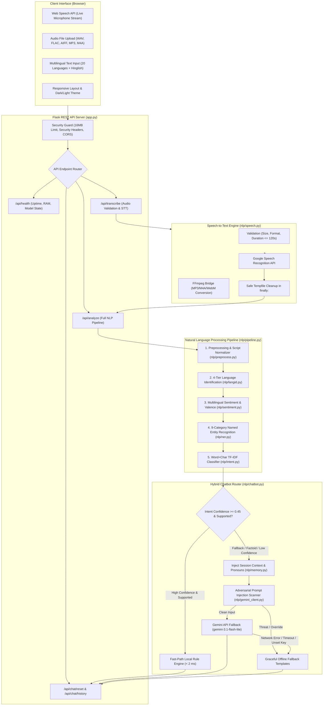

# Vaani AI — System Architecture & Technical Design

## 1. Executive Architecture Overview

Vaani AI is an enterprise-grade multilingual conversational assistant and voice-to-text platform built on a lightweight Flask backend, modern frontend UI, offline machine learning models, and a secure hybrid conversational router connecting Google Gemini.

---

## 2. Core Subsystems

### 2.1 Natural Language Processing Pipeline
The sequential NLP pipeline executes in under **10 ms** locally on CPU:

1. **Preprocessing (`nlp/preprocess.py`)**:
   - Applies Unicode NFKC normalization.
   - Cleans Indian punctuation, dandas (`।`, `॥`), and universal punctuation.
   - Preserves original input for entity extraction while normalizing text for classifier matching.
   - Detects mixed scripts across Devanagari, Gujarati, Bengali, Tamil, Telugu, Arabic, Cyrillic, CJK, and Latin.
   - Normalizes Romanized Hindi (Hinglish) phonetics using a 40+ marker vowel/consonant mapper.

2. **Language Identification (`nlp/langid.py`)**:
   - 4-Tier hierarchical detection engine:
     - *Tier 1 (Script Routing)*: Exact Unicode block mapping for unambiguous scripts (Gujarati, Bengali, Tamil, Telugu, Arabic, Cyrillic, CJK).
     - *Tier 2 (Devanagari Disambiguation)*: Distinguishes Hindi from Marathi using diagnostic marker tokens (*आहे, नाही, आणि, करतो*).
     - *Tier 3 (Latin Script Routing)*: Resolves Hinglish vs. European languages (English, Spanish, French, German, Italian, Portuguese, Dutch).
     - *Tier 4 (Statistical Fallback)*: Trigram and lexicon probability backoff.

3. **Sentiment Analysis (`nlp/sentiment.py`)**:
   - English: Native VADER valence calculation.
   - Indic & Multilingual: Lexicon valence dictionaries for 20 languages.
   - Bidirectional SOV negation window (e.g. *नहीं, नाही, નથી, nahi*) detecting negated predicates.
   - CJK span matching with character-length descending priority.
   - Universal emoji valence injection.

4. **Named Entity Recognition (`nlp/ner.py`)**:
   - Multi-category pattern and gazetteer recognition for:
     `PERSON`, `LOCATION`/`CITY`, `ORGANIZATION`, `DATE`, `TIME`, `PHONE`, `EMAIL`, `MONEY`, `NUMBER`, `LANGUAGE`.
   - Strips trailing SOV copulas (*है, आहे, છે, ہے*) in Indic languages.
   - Protects against common sentence-starting Title Case false positives in Latin scripts.

5. **Intent Classification (`nlp/intent.py`)**:
   - Champion Model: Dual Word (1-2 gram) + Character (3-5 gram) TF-IDF Vectorizer coupled with calibrated Logistic Regression (`C=12.0`, `class_weight='balanced'`).
   - Trained on Amazon MASSIVE (`en`, `hi`, `bn`, `ta`) and regional curated sets (`gu`, `mr`, `hinglish`).
   - Accuracy: **93.86%**, Macro F1: **82.99%** on held-out test split.

---

### 2.2 Hybrid Conversational Engine (`nlp/chatbot.py`)
- **Fast-Path Offline Routing**:
  - High-confidence local intents ($\ge 0.45$) execute in $< 2\text{ ms}$ offline with zero network latency or token quota consumption:
    `ask_time`, `ask_date`, `joke`, `weather`, `music`, `alarm_set`, `greeting`, `goodbye`, `thanks`, `translate_request`.
- **Gemini API Integration (`nlp/gemini_client.py`)**:
  - Open-ended, general knowledge, or low-confidence queries route to `gemini-3.1-flash-lite` (with automated fallback to `gemini-3.5-flash-lite` and `gemini-flash-latest`).
  - Strict 10.0-second timeout with non-blocking offline template fallbacks.
  - Zero API key leakage: credentials strictly read from environment variables (`.env`).
  - Pre-request adversarial scanner rejecting prompt injections, DAN triggers, and credential dump attempts.

---

### 2.3 Conversational Memory & Context (`nlp/memory.py`)
- **Thread-Safe Session Registry (`MemoryManager`)**:
  - Protected with re-entrant thread locks (`threading.Lock`).
  - Automatic sliding TTL cleanup (default 3600 seconds / 1 hour) preventing memory leaks on Render free tier.
- **Session Context Window (`SessionMemory`)**:
  - Sliding FIFO turn buffer (default 10 turns = 20 messages).
  - Preserves extracted entities (`context_entities`) across turns.
  - Automatically formats history for Gemini API's native multi-turn schema (`[{"role": "user"|"model", "parts": [{"text": ...}]}]`).
  - Injects entity context when follow-up pronoun references (*"he"*, *"she"*, *"it"*, *"that place"*, *"woh"*) are used.

---

### 2.4 Speech-to-Text Pipeline (`nlp/speech.py`)
- **Browser Live Streaming**:
  - Web Speech API integration in Chrome/Edge.
  - Dynamic BCP-47 speech recognition tag selection.
  - Granular microphone permission alerts (`not-allowed`, `no-speech`, `audio-capture`, `network`).
- **Server Audio Upload (`/api/transcribe`)**:
  - Format support: PCM WAV, AIFF, FLAC natively; MP3, M4A, WebM, OGG via FFmpeg bridge where installed.
  - Bounds checking: Max 10 MB file size and max 120s duration.
  - Guaranteed tempfile cleanup in `finally:` blocks.
  - Optional `auto_analyze=true` parameter allowing 1-step transcription and full NLP analysis.
